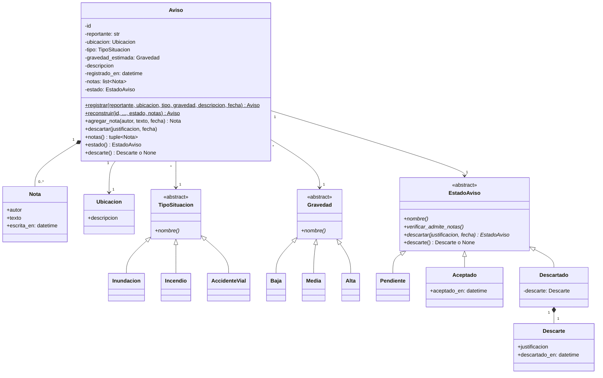
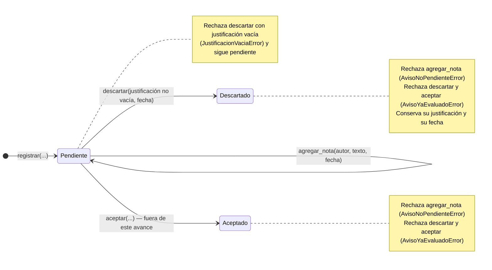

# Avance 1 — Avisos y notas

Rebanada del TP: registrar un aviso, agregarle notas y descartarlo (§2.1 y §7.1).

## Clases que encontre para la rebanada

| Clase | Qué es | Por qué |
| --- | --- | --- |
| `Aviso` | Entidad | Dos avisos con los mismos datos son avisos distintos, y un aviso cambia de estado sin dejar de ser el mismo. Por eso tiene `id`. Es el que tiene las reglas. |
| `Nota` | Valor inmutable | Autor, texto y fecha nacen juntos y no cambian nunca. No puede existir una nota sin autor. |
| `Descarte` | Valor inmutable | Justificación y fecha nacen juntas. No puede existir un descarte sin justificación. |
| `Ubicacion` | Valor inmutable | Agrupa los datos del lugar y valida que no esté vacía. Si después se agrega dirección o referencia, el aviso no cambia. |
| `TipoSituacion` (`Inundacion`, `Incendio`, `AccidenteVial`) | Valor con opciones fijas | Clase abstracta con una subclase por valor. Hoy solo responde su nombre; cuando haya misiones va a tener que responder qué misiones admite (tabla 6.4). |
| `Gravedad` (`Baja`, `Media`, `Alta`) | Valor con opciones fijas | Igual que el tipo. Más adelante va a necesitar su prioridad para ordenar emergencias. |
| `EstadoAviso` (`Pendiente`, `Aceptado`, `Descartado`) | Patrón State | El aviso está en un solo estado a la vez. Cada estado decide qué operaciones acepta. |

## Diagrama de clases

- **Aviso — Nota (composición, 1 a 0..\*):** una nota no existe fuera de su aviso.
- **Descartado — Descarte (composición, 1 a 1):** el descarte vive dentro del estado. Así el aviso no tiene un campo `justificacion` vacío mientras está pendiente.
- **Aviso — Ubicacion, TipoSituacion, Gravedad (asociación):** cada aviso tiene exactamente uno de cada uno.
- **Aviso — EstadoAviso (asociación, 1 a 1):** el aviso tiene un solo estado a la vez.

El reportante y el autor de una nota se guardan como identificador (texto). El aviso no necesita más que eso: las reglas sobre el reportante las resuelve el aviso comparando ese identificador.

## Diagrama de estados del aviso

Qué acepta y qué rechaza cada estado:

| Estado | `agregar_nota` | `descartar` | `aceptar` (no implementado) |
| --- | --- | --- | --- |
| `Pendiente` | Agrega la nota | Pasa a `Descartado` si la justificación no está vacía; si no, `JustificacionVaciaError` y sigue pendiente | Pasaría a `Aceptado` |
| `Descartado` | `AvisoNoPendienteError` | `AvisoYaEvaluadoError` (conserva la justificación original) | `AvisoYaEvaluadoError` |
| `Aceptado` | `AvisoNoPendienteError` | `AvisoYaEvaluadoError` | `AvisoYaEvaluadoError` |

Cada estado devuelve el estado siguiente y el aviso es el único que lo guarda (`self._estado = self._estado.descartar(...)`). No hay ningún método público para cambiar el estado a mano.

## Tarjetas CRC

**Aviso**

| Sabe | Hace | Colabora con |
| --- | --- | --- |
| id, reportante, ubicación, tipo, gravedad estimada, descripción, fecha de registro, sus notas y su estado | Se registra pendiente y sin notas. Agrega notas. Se descarta. Muestra sus notas como tupla (no se pueden agregar por afuera) y su descarte si lo tiene. | `EstadoAviso`, `Nota`, `Ubicacion`, `TipoSituacion`, `Gravedad` |

**EstadoAviso** (abstracta)

| Sabe | Hace | Colabora con |
| --- | --- | --- |
| — | Define lo que todo estado tiene que responder: su nombre, si admite notas, cómo se descarta y cuál es su descarte (por defecto, ninguno). | — |

**Pendiente**

| Sabe | Hace | Colabora con |
| --- | --- | --- |
| — | Admite notas. Al descartar, arma el `Descarte` y devuelve un estado `Descartado`. | `Descarte`, `Descartado` |

**Aceptado**

| Sabe | Hace | Colabora con |
| --- | --- | --- |
| Fecha y hora de aceptación | Rechaza notas (`AvisoNoPendienteError`). Rechaza el descarte (`AvisoYaEvaluadoError`). | — |

**Descartado**

| Sabe | Hace | Colabora con |
| --- | --- | --- |
| Su `Descarte` | Rechaza notas (`AvisoNoPendienteError`). Rechaza un segundo descarte (`AvisoYaEvaluadoError`). Responde su descarte. | `Descarte` |

**Nota**

| Sabe | Hace | Colabora con |
| --- | --- | --- |
| Autor, texto, fecha y hora | Se valida al crearse (autor y texto no vacíos, fecha válida). No cambia. | — |

**Descarte**

| Sabe | Hace | Colabora con |
| --- | --- | --- |
| Justificación, fecha y hora | Se valida al crearse (justificación no vacía ni solo espacios). No cambia. | — |

**Ubicacion**

| Sabe | Hace | Colabora con |
| --- | --- | --- |
| Descripción del lugar | Se valida al crearse (no vacía). No cambia. | — |

**TipoSituacion** (abstracta)

| Sabe | Hace | Colabora con |
| --- | --- | --- |
| — | Define que todo tipo de situación responde su nombre. No se puede crear sin elegir una de las opciones fijas. | — |

**Inundacion**, **Incendio**, **AccidenteVial**

| Clase | Sabe | Hace | Colabora con |
| --- | --- | --- | --- |
| `Inundacion` | — | Responde su nombre: "inundación" | — |
| `Incendio` | — | Responde su nombre: "incendio" | — |
| `AccidenteVial` | — | Responde su nombre: "accidente vial" | — |

**Gravedad** (abstracta)

| Sabe | Hace | Colabora con |
| --- | --- | --- |
| — | Define que toda gravedad responde su nombre. No se puede crear sin elegir una de las opciones fijas. | — |

**Baja**, **Media**, **Alta**

| Clase | Sabe | Hace | Colabora con |
| --- | --- | --- | --- |
| `Baja` | — | Responde su nombre: "baja" | — |
| `Media` | — | Responde su nombre: "media" | — |
| `Alta` | — | Responde su nombre: "alta" | — |

## Decisiones

**La fecha entra como parámetro.** `registrar`, `agregar_nota` y `descartar` reciben la fecha. Ninguna llama a `datetime.now()`, así los tests saben qué fecha esperar.

**Primero se verifica, después se modifica (R6).** En `agregar_nota`, primero el estado verifica que admite notas y se arma la nota (que valida autor y texto); recién después se agrega a la lista. En `descartar`, el estado arma el descarte (que valida la justificación) y devuelve el estado siguiente; si algo falla, la excepción sale antes de la asignación y el aviso queda igual.

**Los atributos no se exponen.** `aviso.notas` devuelve una tupla, así que `aviso.notas.append(...)` falla. Los datos originales son de solo lectura (`@property` sin setter), así que tampoco se pueden reemplazar desde afuera.

**Un valor fuera del catálogo no llega al aviso.** La consigna lo pide explícitamente, así que el aviso verifica al crearse que el tipo sea un `TipoSituacion` y la gravedad una `Gravedad`. Son los únicos `isinstance` del código, y se usan solo para validar lo que entra.

**Cómo se arma un aviso aceptado sin implementar aceptar.** El aviso tiene dos formas de crearse: `registrar`, el camino normal, que siempre lo crea pendiente; y `reconstruir`, que lo arma tal como estaba guardado, con su estado y sus notas. `reconstruir` va a hacer falta cuando el repositorio lea avisos de la base. El test de R5 lo usa con `Aceptado(...)`. No es una forma de saltear reglas: no cambia el estado de ningún aviso que ya exista.

## ¿Quién verifica que solo su reportante agregue notas?

**El aviso.** La capa que recibe al usuario autenticado lo identifica (lee el token) y verifica que tenga el perfil de reportante. Pero "solo su reportante puede agregar notas" es una regla del dominio, y el dato para aplicarla (quién registró este aviso) lo tiene el aviso. Si la regla quedara en la API, cualquier otro camino que llegue al aviso podría saltearla. Por eso `agregar_nota` ya recibe al autor; en el avance 2 el aviso va a rechazar a quien no sea su reportante.

## Reglas y tests

| Regla | Tests |
| --- | --- |
| R1 — nace pendiente con todos sus datos | `test_r1_*` |
| R2 — notas mientras está pendiente, con autor, fecha y hora | `test_r2_*` |
| R3 — agregar una nota no cambia los datos originales | `test_r3_*` |
| R4 — descartar exige justificación no vacía y la conserva con su fecha | `test_r4_*` |
| R5 — un aviso no pendiente rechaza notas y evaluaciones | `test_r5_*` |
| R6 — una operación rechazada no deja cambios | `test_r4_r6_*`, `test_r5_r6_*`, `test_r6_*` |

Para correrlos: `uv run pytest`.
